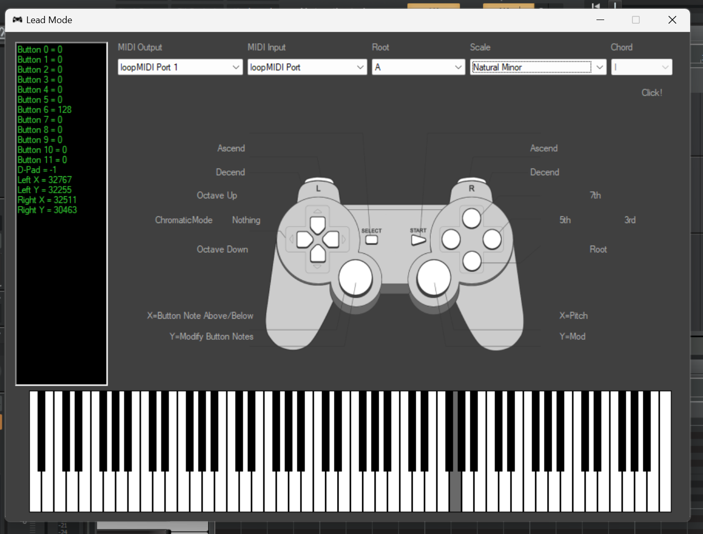

# MIDI Game Controller

### Modes
- **Lead**: 
    - Shoulder buttons ascend/descend selected scale. 
    - Modifiers switch to chromatic. 
    - Buttons jump to target notes.
- **Chord**: 
    - Shoulder buttons play chord notes. 
    - Buttons specify which chord is played. 
    - D-Pad sets chord octave & inversion.
- **Bass**: 
    - Buttons repeat notes at a specific rhythm. 
    - Note is specified by shoulder button combos.
- **Drum**: 
    - Shoulder buttons play Kick, Snare, Crash & China. 
    - Buttons play Hat/Ride patterns.

